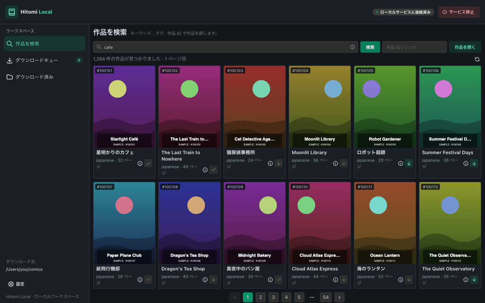
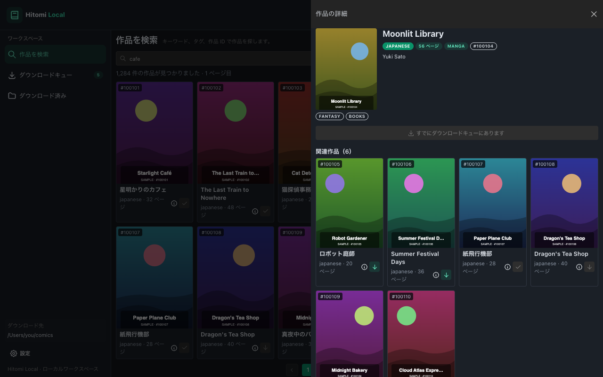
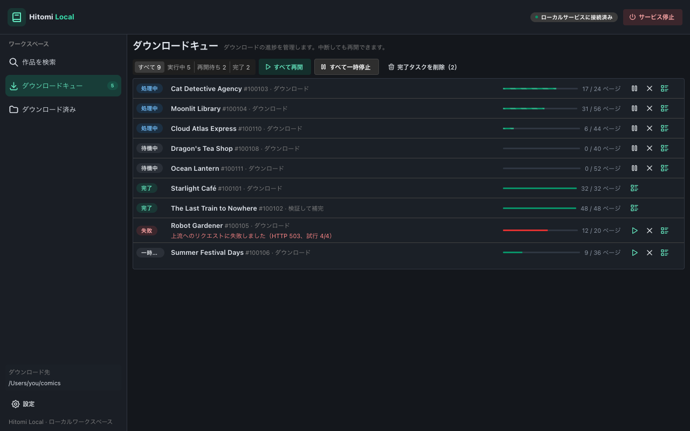
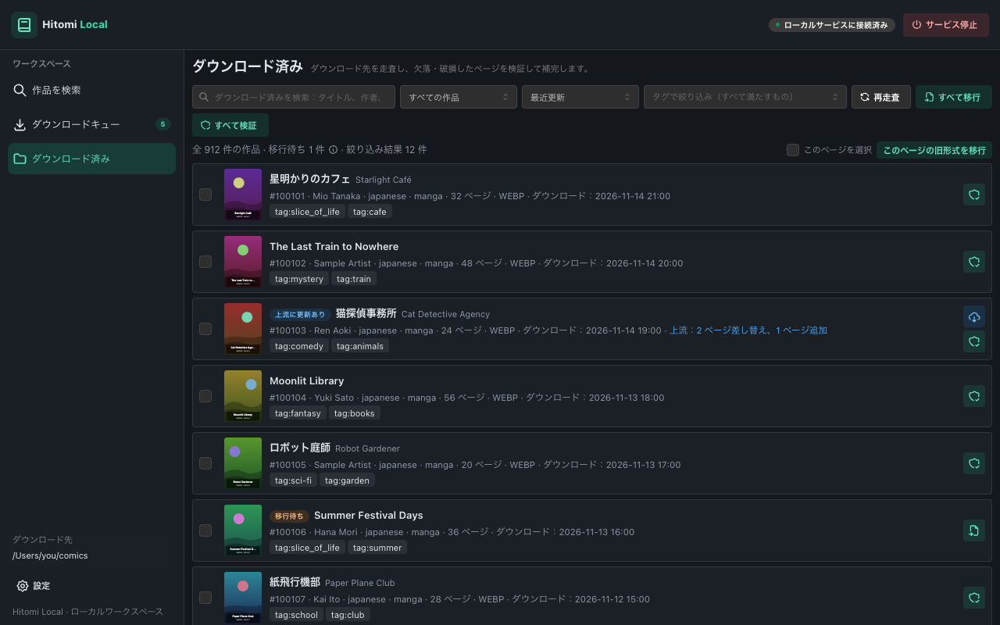
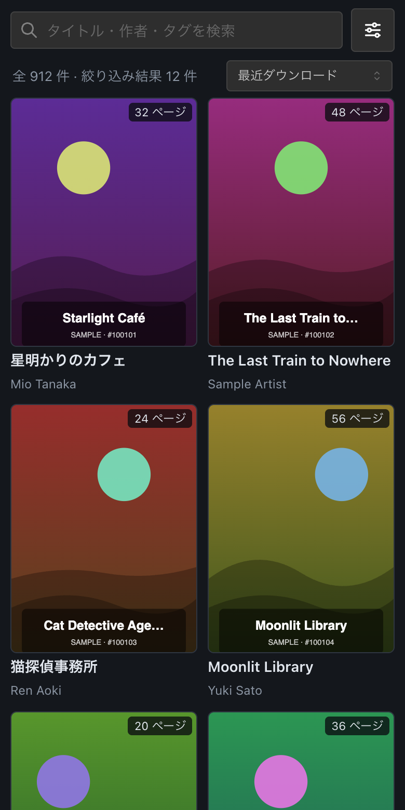
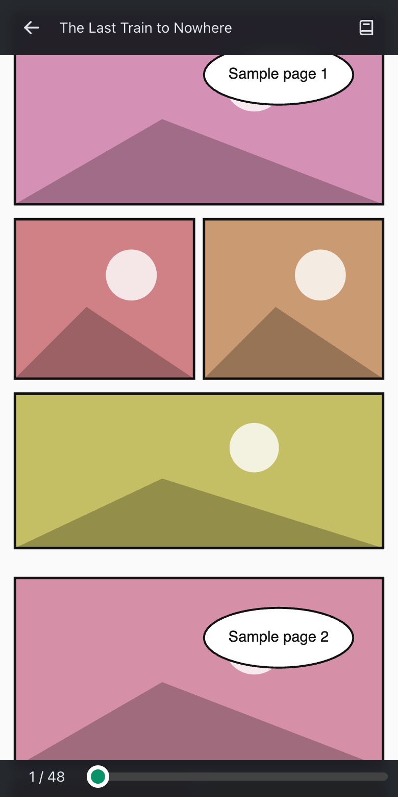

# Hitomi Local

[English](README.md) · [简体中文](README.zh-CN.md) · **日本語**

Go 製の CLI がローカルの HTTP GUI（React、TypeScript、Mantine）を起動します。フロントエンドは Go のバイナリに埋め込まれているため、配布・実行するのは単一の実行ファイルだけです。

Linux / Windows / macOS 用のビルド済みバイナリは [Releases](https://github.com/SinxLinonZ/hitomi-downloader/releases) にあります。

## 免責事項

このプロジェクトは**学習・研究を目的としたもの**です（たとえば Go + React アプリの作り方や、Web プロトコルの仕組みを学ぶためなど）。コンテンツの保存や配布は一切行いません。

**違法コピー（海賊版）の利用を推奨・支援するものではありません。**作者や出版社の権利、およびアクセスするサイトの利用規約を尊重し、気に入った作品は正規の手段で応援してください。このソフトウェアの使い方やダウンロードしたコンテンツについての責任は利用者自身にあり、作者はいかなる利用・誤用についても責任を負いません。

## スクリーンショット

<p align="center">
  
  
</p>
<p align="center">
  
  
</p>
<p align="center">
  
  
</p>

上段は検索・作品詳細・ダウンロードキュー・ダウンロード済み、下段はスマートフォン向け閲覧ページです。表示している作品はすべて、このドキュメントのために用意した架空のサンプルです。

## ビルドと実行

Go 1.23 以上と、Node.js 20.19 以上または 22.12 以上が必要です。

```sh
cd web
npm ci
npm run build
cd ..
go build -o hitomi-downloader ./cmd/hitomi-downloader
./hitomi-downloader
```

起動するとデフォルトのブラウザが自動で開きます。ターミナルに表示されるリンクを開いても構いません。フロントエンドはバイナリに埋め込まれているので、配布時にバイナリだけを渡せば足り、実行時に Node.js は不要です。

```sh
./hitomi-downloader --port 8080 --download-dir /absolute/path/to/downloads
./hitomi-downloader --proxy http://127.0.0.1:7890
./hitomi-downloader --lan   # 同じ LAN のスマートフォンから閲覧ページを開けるようにする
./hitomi-downloader --lang ja   # ターミナル出力とメッセージの言語：auto、zh、ja、en
./hitomi-downloader --proxy direct --no-open --data-dir /absolute/path/to/state
```

**言語**：GUI とターミナル出力は日本語・簡体字中国語・英語に対応しています。GUI は既定ではブラウザの言語に従い、「設定」→「表示言語」で変更できます。その選択は `data/config.json` にも保存され、ターミナル出力とサーバーのメッセージに使われます。ターミナルの言語は `--lang` ＞ 保存済みの設定 ＞ 環境変数 `HITOMI_LANG` / `LC_ALL` / `LANG` の順に決まります（どれにも一致しなければ英語）。タスク記録に保存済みのメッセージ（タスクのエラーなど）は、書き込まれた時点の言語のままです。

既定では `127.0.0.1` のランダムなポートで待ち受けます。ダウンロード先の既定は作業ディレクトリ直下の `downloads`、設定とタスク記録は `data` に保存されます。GUI で保存したダウンロード先は次回起動時に復元され、CLI の `--download-dir` はそれを上書きします。Proxy は既定で環境変数 `HTTP_PROXY`、`HTTPS_PROXY`、`NO_PROXY` に従います。CLI が表示するセッションリンクは、この端末用の HTTP-only Cookie を確立するためのものです。再起動したら新しいリンクを使ってください。

GUI は dark theme で、固定ヘッダーとサイドバーを持つ Mantine AppShell です（モバイルでは左上のボタンでナビゲーションを開きます）。内容領域は高密度に作られています：ページのタイトルと説明は 1 行にまとめ、各ページの検索・絞り込みツールバーは上部に固定、検索結果は表紙のグリッド、ダウンロードキューはコンパクトな表（「すべて / 処理中 / 再開待ち / 完了」で絞り込み、1 ページ 100 件）、「ダウンロード済み」は 1 ページ 50 件の 2 列リストです。`/` キーで現在のページの検索欄にフォーカスできます。ヘッダーの「サービス停止」と、ターミナルでの Ctrl+C / SIGTERM は同じ終了処理を使います：接続中のページに SSE の再接続をやめるよう通知し、処理中の HTTP リクエストを取り消し、ダウンロードを一時停止して進捗を保存し、接続を閉じ切ってから終了します。停止後はページの操作が無効になるので、再開するときは CLI を実行し直して新しいリンクを開いてください。

タスクの状態は SSE で配信されます。タスク一覧が変化したときだけ送信し、アイドル時は 15 秒ごとに keep-alive を送ります。

## スマートフォン向け閲覧ページ

`/reader` はスマートフォン向けの閲覧ページで、できることは 4 つだけです。ダウンロード済みの作品の閲覧（表紙の 2 列表示、スクロールで追加読み込み）、絞り込み（キーワード、および下から出るドロワーでの複数タグ絞り込み。選んだタグはすべて満たす必要があります）、並べ替え（リスト右上のプルダウン：最近ダウンロード / 最も古いダウンロード / 最近更新。既定は最近ダウンロードで、選択はその端末に記憶されます）、そして読むことです。

戻る操作：作品と絞り込みドロワーはそれぞれブラウザ履歴を 1 件使います（URL の hash は `#/w/ID`、`#/filter`）。そのため、スマートフォンの戻るジェスチャー／キーも、ページ内の「戻る」ボタンも、それらを閉じて一覧に戻るだけです。再読み込みの後や、リンクから作品を直接開いた場合、「戻る」ボタンは別のページへ移動せず、現在の履歴を一覧に置き換えます。

- **閲覧**：既定は縦スクロールで、現在のページの前後の画像だけを読み込みます（ページ数が多い作品でもメモリを圧迫しません）。下部のスライダーでページを移動できます。「ページめくり」モードに切り替えると、画面の左右をタップするか左右にスワイプしてめくれ、右開きにも切り替えられます。画面中央をタップするとツールバーの表示／非表示を切り替えます。閲覧位置と表示設定はその端末のブラウザにだけ保存され、一覧には「n/総ページ数まで読んだ」と表示されます。
- **画像の取得元**：ローカルにダウンロード済みの画像を読み込み、Hitomi にはアクセスしません。ブラウザが表示できない形式（環境によっては JXL など）は欠落ページとして表示されます。旧形式（未移行）の作品も閲覧できます。
- **表紙**：検索ページでキャッシュ済みのサムネイルを優先し、なければ作品の最初のページを使います。そのため、初めて一覧を開いたときは表紙のサイズが大きいことがあります。

### スマートフォンから接続する

既定ではこの PC からしか接続できません。必要なときは `--lan` を付けて起動します：

```sh
./hitomi-downloader --lan
```

ターミナルにスマートフォン用のリンクが表示され、GUI の「設定」にもリンクと QR コードが表示されます。スキャンするかリンクを開いてください（PC と同じ LAN に接続している必要があります）。セキュリティ設計：

- リンクに入っているのは**閲覧専用のトークン**で、管理用の起動トークンとは別物です。`data/reader-token` に保存され（再起動してもリンクは変わらず、このファイルを削除して再起動すればリセットされます）、閲覧ページと閲覧用 API にしかアクセスできません。ダウンロード、検証、移行、設定変更はできません。
- 他の端末からのリクエストには管理権限が一切ありません。管理用トークンや Cookie を入手しても閲覧ページしか使えず、管理画面のトップは `/reader` にリダイレクトされます。
- LAN 内では平文の HTTP を使うため、トークンは暗号化されずに送られます。信頼できる家庭内ネットワークでのみ使ってください。閲覧用 API が返すのは作品情報と画像だけで、ファイルパスは公開しません。
- `--lan` を付けない場合の動作は従来と同じで、`127.0.0.1` だけで待ち受けます。

## 検索とダウンロード

- 通常のキーワードは AND（共通部分）で絞り込みます。`artist:name`、`group:name`、`series:name`、`character:name`、`language:japanese`、`type:manga`、`tag:name`、`female:name`、`male:name` でタグ検索できます。
- タグ値の空白はアンダースコアにします：`artist:some_artist`。語の前に `-` を付けると除外です（例：`language:japanese -tag:anthology`）。
- gallery ID や作品のリンクで詳細を開けます。詳細ドロワーの下部には Hitomi の「関連作品」（gallery 情報の `related`、最大 40 件）が表示され、そこから別の作品を開いて前の作品に戻れます。検索結果の一部のページが失敗しても成功したカードは残り、そのページを再試行できます。
- 既定では 2 作品を同時に処理し、1 作品あたり最大 4 ページを並行で取得します。どちらも GUI の「設定」で変更でき（同時タスク数 1–8、タスクあたりの並行ファイル数 1–16）、起動オプション `--task-concurrency`、`--page-concurrency` で上書きもでき、`data/config.json` に保存されます。タスク数は待機中のタスクに即座に反映され、ファイル並行数は新しく開始・再開するタスクに反映されます。HTTP リクエストは全体で最低 200ms の間隔を空けて送られ、上流に一気に負荷をかけないようにしているため、並行数を極端に上げても比例して速くはなりません。移行タスクは純粋なローカル I/O なので独自の並行数（4 タスク、各 8 ページ）を使い、上記の設定の影響を受けません。
- ネットワークエラー、408、429、5xx は、exponential backoff と jitter を使って最大 4 回試行し、`Retry-After` を尊重します（60 秒を超える要求は再試行可能なエラーとして返します）。
- まず metadata に記録されたソースファイルの元の形式を試します。元の形式が 403/404 を返したときは `gg.js` を強制的に取得し直して再試行し、それでも使えない場合にだけ、利用可能な JXL、AVIF、WebP を試します。元の形式（および JXL）に使うホスト名が解決できない（DNS に存在しない）場合も、その形式は利用不可として待たずにすぐフォールバックします。テストした環境では、`gold-usergeneratedcontent.net` のうち `1.`、`2.`、`j1.` で始まるホストは存在せず、`w1.`（WebP）と `a1.`（AVIF）は解決できました。そのため現状では実際には AVIF か WebP にフォールバックし、その理由が metadata に記録されます。派生形式の順序は固定のフォールバック順で、画質の高低を保証するものではありません。クライアント側での再エンコードは行いません。
- ネットワークのタイムアウトや 5xx では形式のダウングレードは行いません。ページの形式、フォールバックの理由、ソース hash はすべて metadata に保存されます。
- 一時停止やキャンセルはリクエストを止め、完了済みのページを保持します。再開時はページの SHA-256 を照合し、未完了または破損したページだけを再ダウンロードします。1 枚の画像についてのバイト単位の Range 再開は行いません。一時停止・キャンセル・終了・クラッシュのいずれでも完了済みのページは削除されません。書き込み途中のページは一時ファイル `.page-*.part` にだけ存在し、完了扱いにはならず、次にタスクを開始するときに片付けられます。

## ファイル構成と復旧

```text
downloads/
  12345 - Title/
    0001.png
    0002.jpg
    metadata.json
  .downloading-67890/
    metadata.json
    0001.png
data/
  config.json
  tasks/12345.json
  covers/12345.webp
```

`metadata.json` には、元の gallery 情報（上流のすべてのフィールドを保持）、各ページのファイル名、ソース hash、実際の形式、バイト数、ローカルの SHA-256、更新日時が入ります。タスクの進捗は別の JSON に保存され、「ダウンロード済み」の一覧は現在のダウンロード先にある metadata を走査して作るため、データベースは使いません。JSON も画像も一時ファイルに書いてから rename し、完了済みのディレクトリを削除することはありません。

GUI の設定でダウンロード先を変更し、「ダウンロード済み」を開いてください。バックグラウンドの走査が見つかった作品を順に表示し、現在のディレクトリ、確認済みのディレクトリ数、読み取り時の警告を示します。走査は取り消せます。作品の metadata が見つかったら、そのディレクトリ内の画像やサブディレクトリは列挙しません。アプリの実行中はメモリ上のインデックスを再利用するのでページを切り替えても再走査せず、「再走査」で手動更新します。再起動後はファイルを改めて検出します。ネットワークマウント上の OS の I/O は Go から強制的に中断できないため、取り消しは実行中の I/O が戻った後に有効になります。

「ダウンロード済み」は 1 ページ 50 件のリストです（広い画面では 2 列）。ローカルの最初の画像による遅延読み込みの表紙、タイトル、作者、言語、ページ数、形式を表示します。タイトル・作者・ID での絞り込み、metadata 形式での絞り込み、ページをまたいだ選択に対応します。並べ替えは「最近更新」または「ダウンロード時間」（新→旧 / 旧→新）です。ダウンロード時間は作品ディレクトリの作成時刻（macOS と Windows では birthtime、それ以外の環境ではディレクトリの更新時刻で代用）なので、後から検証で `metadata.json` が書き換えられても影響を受けません。表紙は Hitomi がオンラインでなくても表示できます。ブラウザが JXL を表示できない場合はプレースホルダーになります。リストには namespace 付きのタグ（`female`、`male`、通常の `tag`）が表示され、タグをクリックするとそのまま絞り込みに追加されます。タグが多いときは展開できます。検索欄は「ダウンロード済みを検索」と明示されており、入力するとローカルのインデックスからタイトル、作者、ID、タグを自動で検索します。複数の語は AND で、`female:glasses`、`female:long_hair`、`-tag:digital` などの条件に対応します。別に用意した検索可能なタグの複数選択欄には作品数が表示され、複数のタグは AND で組み合わせられ、テキストや metadata 形式の絞り込みと同時に使えます。新規ダウンロードでも旧データの移行でも、`metadata.json` の `gallery.tags` の元のフィールドは完全に保持されます。検索には正規化したインデックスを使い、元のタグを書き換えたり削ったりすることはありません。

新形式では、作品ごとの「検証して補完」、選択した作品の一括検証、「すべて検証」ができます。検証は 2 層で行われます：

1. **ローカルの整合性（オフライン）**：metadata に記録された想定ページ数、ファイルサイズ、SHA-256 を照合します。移行直後のページにはまだ SHA-256 の基準値がないため、先にシグネチャと完全デコードの検査を行い、それから基準値を確定します。
2. **Hitomi との比較（オンライン）**：作品ごとに gallery 情報を 1 回取得し、ページごとにソース hash を比較します（これは元画像そのものを識別するもので、ローカルが webp、avif、元画像のどれであっても関係ありません）。

2 層の結果を合わせて、「ローカルの破損」と「上流の更新」を区別します：

| ローカルのページ | 上流の hash | 結果 |
| --- | --- | --- |
| 正常 | 一致 | 正常 |
| 欠落または破損 | 一致 | ローカルの破損：自動で再ダウンロード |
| 任意 | 不一致 | 上流がそのページを差し替えた：報告のみ。ローカルは上書きせず、旧版も再ダウンロードしない |
| — | 上流にページが増えている | 上流で追加：報告のみ |
| あり | 上流にない | 上流で削除：報告のみ。ローカルのファイルは削除しない |
| — | gallery が 404 | 作品が上流で削除された：印を付けるだけでローカルの内容は変えず、欠落ページの補完もできない |
| — | ネットワークまたはプロトコルのエラー | 不明：ローカルの検査だけを行い、既存の上流状態は変更しない |

上流の状態は `metadata.json` の `upstream` フィールドに保存されます。「ダウンロード済み」の一覧には「上流に更新あり / 上流で削除」と表示され、それらで絞り込めます。タイトルやタグなど metadata だけの変化は差分に数えず、ローカルの metadata を書き換えることもありません。

ローカルの内容を変更するのは「上流の更新を適用」（作品単位、または選択して一括）だけです。差し替え・削除された旧ページは `superseded/<時刻>/` に移動され（削除はされません）、差し替え後のページと追加ページをダウンロードし、gallery 情報を上流のものに更新します。

オンラインの比較は最大 2 回試行します。一度接続に失敗すると、その後 1 分間の検証ではオンライン比較を飛ばし、一括検証で作品ごとに待たされないようにします。オフラインでも、ページが揃っている作品はローカル検査を完了できますが、欠落ページの補完にはネットワークが必要です。タスクの詳細には失敗したページが具体的に表示されるので、ネットワークが戻ったら「再開 / 再試行」を押してください。

プログラムの終了やクラッシュの後、未完了のタスクは一時停止状態に戻ります。ダウンロード先を変更した場合、元のディレクトリの未完了タスクは元のディレクトリに戻してから再開する必要があります。移動した完全な作品は、新しいディレクトリでそのまま走査・検証できます。同じ gallery ID のタスクは同時に 1 つしか実行されません。

ダウンロードキューは「処理中 → 待機中 → 一時停止/失敗/キャンセル → 完了」の順にグループ化され、処理中と待機中はキューに入れた順に並ぶので、進捗が変わっても行の順序は変わりません。すでにダウンロード先にある作品は再度「ダウンロード」できません：検索結果、関連作品、詳細にあるダウンロードボタンはグレーアウトされ（ホバーすると「ダウンロード済み」または「すでにダウンロードキューにあります」と表示）、サーバーも 409 `ALREADY_DOWNLOADED` で拒否します。補完したいときは「検証」を使ってください。判定は走査済みのローカルインデックスに基づき（走査が終わっていない間は、すでに見つかった作品だけを止めます）、ディレクトリがまだ存在することも確認します。

すべての一括操作（すべて再開 / すべて一時停止 / 完了タスクを削除、および「ダウンロード済み」ページのすべて移行、すべて検証、選択を移行、選択を検証、上流の更新を適用）は、実行前に件数と影響を示す確認ダイアログを表示します。既定のフォーカスは「キャンセル」で、キャンセルしてもサーバーには何も送られません。作品 1 件に対する操作に確認はありません。

ダウンロードキューには「すべて一時停止」「すべて再開」「完了を非表示」「完了タスクを削除」があります。すべて一時停止は、待機中・実行中のダウンロード、移行、検証タスクが対象です。すべて再開は、一時停止・失敗・キャンセルされた未完了のタスクを再開し、完了済みや実行中のタスクは飛ばします。一時停止の直後にすべて再開しても、古い worker が終わるのを待つので、同じタスクが二重に処理されることはありません。ダウンロード先の不一致などの失敗はタスクごとに報告されます。

「完了を非表示」はキューの表示にだけ影響します。「完了タスクを削除」が消すのは `data/tasks/{id}.json` のタスク記録とメモリ上の対応するタスクだけで、ダウンロード先には触れず、画像や作品の metadata を削除せず、「ダウンロード済み」の一覧から作品を外すこともありません。未完了のタスクは整理されません。完了記録は worker の最後の保存が終わってから削除でき、削除した記録は再起動しても復活しません。

[lanyeeee/hitomi-downloader](https://github.com/lanyeeee/hitomi-downloader)（Tauri アプリ）が書き出すフラットな `metadata.json` は「移行待ち」としてだけ認識され、走査や検証の入口が自動で書き換えることはありません。作品単位の「移行」、選択後の「選択を移行」、「このページの旧形式を移行」、上部の「すべて移行」を押すと、タスクは既存の画像のファイルサイズ、形式のシグネチャ、画像ヘッダーだけを確認します（全内容は読まないので、ネットワークドライブでも高速です。移行タスクはダウンロードより高い並行度で動きます）。再ダウンロードも画像の変更も行いません。SHA-256 の基準値は、その作品の最初の「検証して補完」まで先送りされます。完了前に metadata が他のプログラムに変更されていないかを確認し、元のファイルを `metadata.legacy.json` に保存して、新しい metadata をアトミックに書き込みます。異なる内容のバックアップがすでにある場合は、移行を止めてエラーを報告します。旧フィールド（例：camelCase のタイトルや文字列の作者リスト）は新しい構造に変換され、元のフィールドの情報も保持されます。「すべて移行」は走査の完了を待ち、絞り込みやページ分割に関係なく、現在のダウンロード先にあるすべての旧 metadata が対象です。まず対象のスナップショットを固定し、すでにアクティブなタスクがある作品を飛ばしてから、100 件ずつキューに追加します。進捗は引き続きダウンロードキューで確認できます。

旧画像の欠落や破損、同じページに複数の形式がある場合、移行は具体的なページと警告を記録し、元の画像を残します。あとで「ダウンロード済み」から検証して補完してください。移行を一時停止またはキャンセルしても旧 metadata は保持され、再開時にローカルの画像を読み直します。metadata を書き込んだ後にプログラムが終了しても、タスクの状態を復元できます。移行によって旧画像の符号化品質が上がることはなく、旧ダウンローダーが新しい metadata を読めることも保証されなくなります。Node スクリプトでエクスポートした gallery JSON は完全なダウンロードディレクトリではないため、直接はインポートしません。

ローカルの SHA-256 はダウンロード後のファイルの変化を検出するためのもので、上流の画像が本物であることを遠隔で証明するものではありません。ソース hash とローカルファイルの SHA-256 は別々に保存されます。JPEG、PNG、GIF はダウンロード時に完全デコードで検査し、WebP、AVIF、JXL はファイルのシグネチャとレスポンス長を検査します。その後はいずれも SHA-256 でファイルの変化を確認します。metadata 自体が壊れているとページ一覧を確実には推定できないため、先に metadata を復旧する必要があります。認識できないディレクトリを勝手に上書きすることはありません。

## 検証

```sh
go test -race ./...
go vet ./...
cd web
npm ci
npm run build
npm test
```

Playwright のテストは実際の Go バイナリを起動し、ディレクトリの走査、オフライン検証、検索の部分的な失敗、設定の永続化を対象にしているので、先に上記のビルドを実行してください（バイナリにフロントエンドが埋め込まれるため、フロントエンドを変更したらバイナリも再ビルドします）。既定では macOS の Google Chrome を使い、他の OS では `CHROME_PATH` で Chromium の実行ファイルを指定します。テストは一時的なフィクスチャとモックした検索レスポンスを使うので、Hitomi がオンラインである必要はありません。既定の `/tmp` パスが禁止された制限環境では `TMPDIR=/private/tmp` を設定してください。localhost のポートへのバインドが禁止されている場合、ブラウザのテストは起動できませんが、Go の HTTP ハンドラーのテストは実行できます。

フロントエンドを開発するときは、まず `--port 8080` で Go を起動し、ブラウザで CLI のリンクを開いてセッションを初期化してから、`npm run dev` を実行して同じ hostname の Vite のページにアクセスします。Vite は既定で `/api` を `http://127.0.0.1:8080` に転送します。`HITOMI_BACKEND` で変更できます。Cookie の hostname を揃えるため、ブラウザでは常に `127.0.0.1` を使ってください。

`docs/screenshots/` のスクリーンショットは、架空のモックデータから `npm run screenshots` で生成します（先に `npm run build` を実行）。

動的なホスト名と `gg.js` のルーティング規則は、[lanyeeee/hitomi-downloader](https://github.com/lanyeeee/hitomi-downloader) によるプロトコルの実装を参考にしています。プロトコルが変わった場合は明確な解析エラーが報告されるので、`internal/hitomi` のアダプターを更新する必要があります。

## 謝辞と参考

このプロジェクトは [lanyeeee/hitomi-downloader](https://github.com/lanyeeee/hitomi-downloader) のプロトコルに関する知見を参考にしています。Hitomi の gallery 情報、`nozomi` インデックス、`gg.js` のルーティング、画像ホスト名の仕組みは、その実装から学びました。移行機能は、このプロジェクトが書き出すダウンロードディレクトリと `metadata.json` の形式を引き継ぐためのものです。作者に感謝します。
